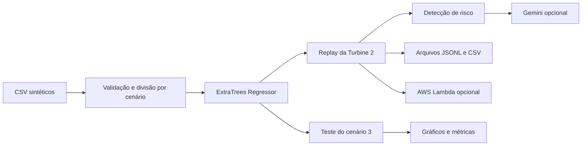

# RUL sintético de bucha Kaplan

Projeto acadêmico para simular analiticamente o desgaste de uma bucha oscilante de turbina Kaplan, treinar um modelo de **Remaining Useful Life (RUL)** e reproduzir o cenário reservado em replay.

Os dados de entrada são os arquivos já presentes na raiz:

- `rul_sintetico_bucha_Turbine_1.csv`
- `rul_sintetico_bucha_Turbine_2.csv`

> Esta é uma demonstração. RUL, desgaste e métricas são derivados de um simulador simplificado e não representam falhas ou dados válidos de uma turbina real.

## Arquitetura



## Estrutura do projeto

```text
main.py                         Ponto único de entrada
src/
  config.py                     Configuração e atributos
  data_loader.py                Carga e validação dos CSVs
  model_training.py             Treino, métricas e artefato
  replay.py                     Replay temporal e eventos
  visualization.py              Gráficos de desempenho
  gemini_integration.py         Integração opcional com Gemini
aws/
  lambda_rul_ingest.py          Handler AWS Lambda/S3/SNS
rul_sintetico_bucha_*.csv       Dados sintéticos de entrada
outputs/                        Modelo, métricas, replay e gráficos
requirements_mancais_kaplan_rul_stream.txt
```

## Instalação

Recomenda-se Python 3.10 ou mais recente.

```bash
python -m venv .venv
source .venv/bin/activate
python -m pip install --upgrade pip
python -m pip install -r requirements_mancais_kaplan_rul_stream.txt
```

No Windows PowerShell:

```powershell
python -m venv .venv
.venv\Scripts\Activate.ps1
python -m pip install --upgrade pip
python -m pip install -r requirements_mancais_kaplan_rul_stream.txt
```

## Execução

Na raiz do projeto:

```bash
python main.py
```

A execução:

1. lê e valida os dois CSVs sintéticos;
2. usa os cenários 1–2 no treinamento;
3. reserva integralmente o cenário 3 para teste e replay;
4. compara `DummyRegressor` e `ExtraTreesRegressor`;
5. reproduz o cenário 3 da `Turbine_2`;
6. gera o modelo, métricas, replay e gráficos em `outputs/`.

## Dados e atributos

Os CSVs contêm sinais já processados pelo simulador. Os atributos usados pelo modelo são:

- médias, mínimos e máximos das pressões de abertura e fechamento;
- presença de glicerol;
- diferença absoluta de pressão;
- proxies de carga e atividade;
- carga normal sintética;
- ciclos sintéticos e distância de deslizamento;
- profundidade sintética de desgaste.

A coluna `RUL_sim_hours` é o alvo sintético. Ela não representa vida útil observada em campo.

## Treinamento e hiperparâmetros

O modelo principal utiliza:

- `ExtraTreesRegressor`;
- `n_estimators=500`;
- `min_samples_leaf=2`;
- `max_features=0.85`;
- `n_jobs=-1`;
- `random_state=42`.

A linha de base utiliza `DummyRegressor(strategy="median")`. Os modelos são avaliados no cenário reservado por MAE, RMSE e R².

Na execução atual, o modelo alcançou aproximadamente:

- MAE: `847 h`;
- RMSE: `1190 h`;
- R² sintético: `0,856`.

Esses valores medem consistência com o simulador e não precisão de manutenção preditiva em equipamento real.

## Risco e replay

O replay utiliza a `Turbine_2`, cenário 3. Cada amostra gera um evento com:

- identificador do evento;
- instante e tempo do replay;
- RUL previsto;
- limite de risco;
- estado de risco;
- transição de risco;
- indicação de dados sintéticos.

O limite padrão é `720 h` (30 dias), apenas demonstrativo. Uma transição ocorre quando a previsão começa a ficar menor ou igual ao limite.

A referência `RUL_sim_hours` é mantida apenas nos arquivos locais de avaliação. Ela não deve ser incluída em um payload externo.

## Gemini (opcional)

A integração está em `src/gemini_integration.py`. Configure as variáveis de ambiente:

```bash
export GEMINI_API_KEY="sua-chave"
export GEMINI_MODEL="gemini-2.0-flash"
```

No Windows PowerShell:

```powershell
$env:GEMINI_API_KEY="sua-chave"
$env:GEMINI_MODEL="gemini-2.0-flash"
```

O chamamento deve ser ativado apenas na transição para risco. A resposta é auxiliar, não substitui análise humana e não deve prescrever ação automática de manutenção.

Não versionar a chave Gemini.

## AWS Lambda, S3 e SNS (opcional)

O handler está em `aws/lambda_rul_ingest.py`. Ele recalcula o risco, grava o evento no S3 e pode publicar uma notificação SNS somente em uma transição para risco.

Variáveis necessárias na Lambda:

- `S3_BUCKET`;
- `SNS_TOPIC_ARN`;
- `RISK_THRESHOLD_HOURS` (padrão: `720`).

Configure:

1. um bucket S3;
2. um tópico SNS e suas assinaturas;
3. uma função Lambda usando o handler `lambda_rul_ingest.lambda_handler`;
4. permissões mínimas de `s3:PutObject` e `sns:Publish`;
5. e teste a Lambda com um evento sintético antes de integrar o replay.

## Artefatos gerados

Em `outputs/`:

- `modelo_rul_bucha.joblib` — modelo, atributos e metadados;
- `metricas_teste_sintetico.csv` — comparação Dummy/ExtraTrees;
- `previsoes_teste_sintetico.csv.gz` — previsões no cenário reservado;
- `replay_rul_local.csv.gz` — replay com referência sintética local;
- `eventos_supervisor_replay.jsonl` — eventos sem a referência sintética;
- `performance_predito_vs_real.png` — previsto × referência;
- `performance_residuos.png` — distribuição dos resíduos;
- `performance_replay.png` — evolução temporal do replay;
- `performance_feature_importance.png` — importância dos atributos.

## Método do simulador

Os dados são usados como perfil operacional de um simulador simplificado de desgaste. A diferença de pressão e a faixa intraminuto são proxies relativos de carga e atividade. Não são relações físicas validadas por ensaios.

O desgaste utiliza a forma simplificada de Archard:

```text
V = K × W × s / H
h = V / (D × L)
```

O coeficiente `K` não é obtido por ensaio neste projeto e é calibrado artificialmente para uma vida nominal hipotética. O resultado não estima vida real.

## Limitações

- Não há carga normal medida no mancal.
- Não há movimento/ciclos medidos da pá.
- Não há geometria, material ou inspeção validados.
- Não há falhas observadas ou tempo real até falha.
- Pressão diferencial e amplitude são apenas proxies.
- `wear_depth_sim_um` é um estado sintético, não uma medição de sensor.
- Métricas são internas ao simulador e não validam manutenção preditiva em campo.
- O limite de 720 h é demonstrativo e exige definição de engenharia.
- Alertas não devem comandar automaticamente operação ou manutenção.

## Referências técnicas

- Sandström et al. (2025), *Friction Monitoring in Kaplan Turbines*: <https://www.mdpi.com/2075-1702/13/4/313>
- Pereira et al. (2009), *Application of self-lubricating bearings in Kaplan runner hubs*: <https://www.hydropower-dams.com/articles/application-of-self-lubricating-bearings-in-kaplan-runner-hubs/>
- PNNL, *Self-Lubricating Bushing Testing for John Day Dam Kaplan Turbine Replacement*: <https://www.pnnl.gov/publications/self-lubricating-bushing-testing-john-day-dam-kaplan-turbine-replacement>
- Khadke (2023), *Pilot Study: Test Rig for Self-lubricating Kaplan Runner Bearings*: <https://www.diva-portal.org/smash/get/diva2:1737138/FULLTEXT01.pdf>
- U.S. Bureau of Reclamation, *Alignment of Vertical Shaft Hydro Units*: <https://www.usbr.gov/power/data/fist/fist2_1/fist2-1_9.16.pdf>
- Shutin et al. (2023), *Method for On-Line Remaining Useful Life and Wear Prediction for Adjustable Journal Bearings*: <https://www.mdpi.com/2075-4442/11/1/33>
